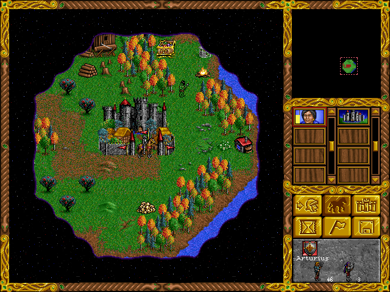

# OpenHeroes1

A reimplementation of **Heroes of Might and Magic I** (1995) in **Godot 4.7**
(4.7.2 tested).

Playable modes: Standard scenarios, the four original campaigns, local 2 to 4
player hot seat, and two-player network play over IP.

## Play it

You need Godot and either your own copy of HOMM1 or the 1995 demo. The art,
music and scenarios are copyrighted, so none of it is in this repository. The
game builds its data from your copy.

Follow the guide for your platform. Each one goes step by step from
installing Godot to building the game data and playing. The Windows, Ubuntu
and macOS guides also cover exporting a build:

- [Windows](docs/windows.md)
- [Ubuntu](docs/linux.md)
- [Steam Deck](docs/steamdeck.md)
- [macOS](docs/mac.md)

## Reporting problems

Bug reports and questions are welcome as GitHub issues.

## License and trademarks

The code and documentation in this repository are released under the MIT
license, see [`LICENSE`](LICENSE).

*Heroes of Might and Magic is a trademark of Ubisoft Entertainment. This project
is not affiliated with or endorsed by Ubisoft, New World Computing or The 3DO
Company. Quotations of in-game text remain the copyright of their owners.*
